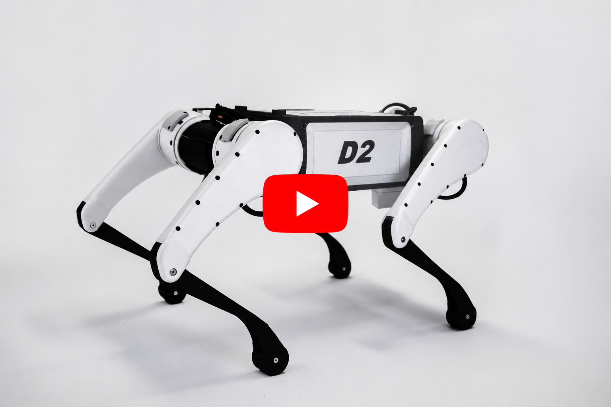
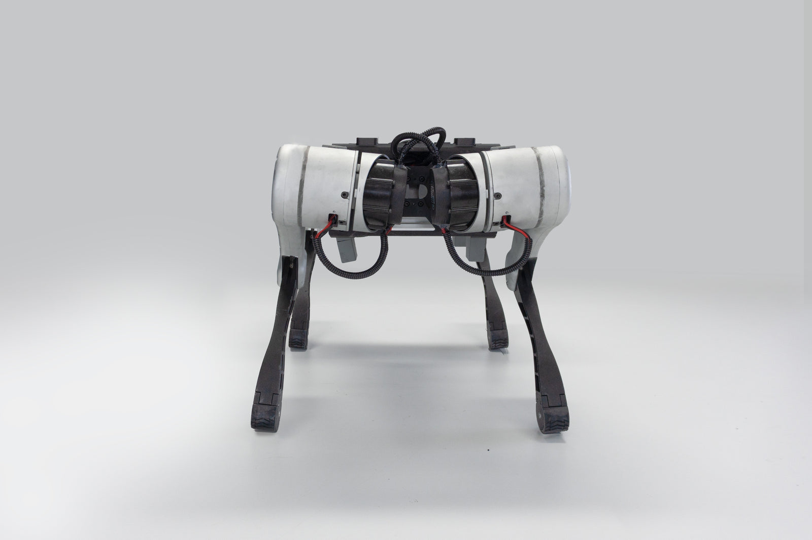
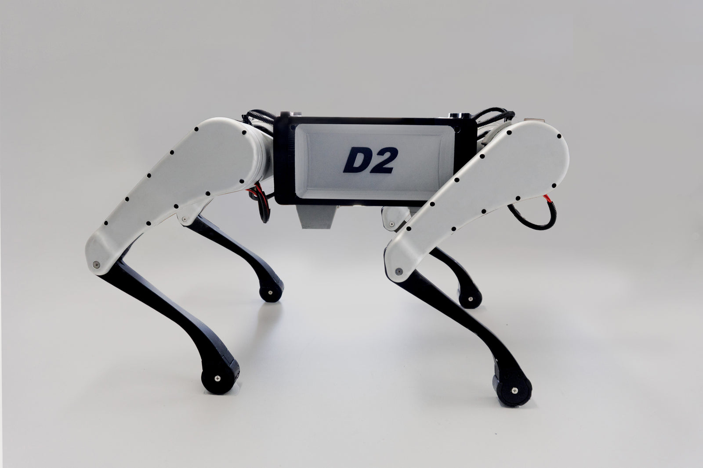
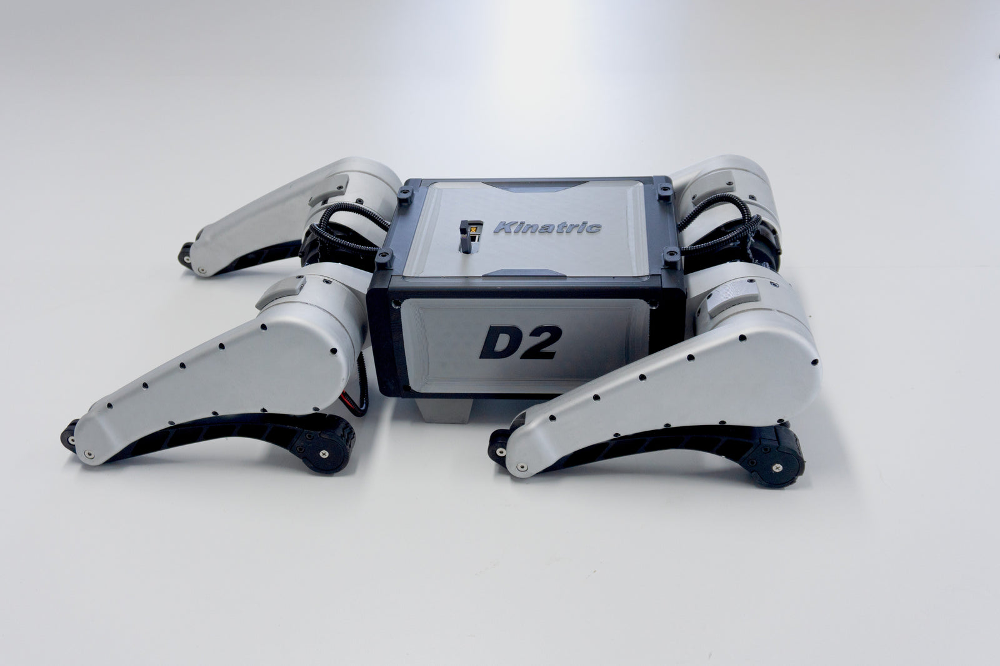

# D2 Open-Source Robotics Project

[](https://github.com/Kinatric/d2)
[](#project-status)
[](LICENSING.md) [](LICENSING.md)

[](https://youtu.be/3pyi0c24YLs)

This is the main repository for the D2 open-source robotics project. It serves as the starting point for project information, hardware resources, technical documentation, and links to companion software repositories.

This repository connects D2 hardware design, motion data, policy training, simulation validation, and deployment resources. Hardware specifications, software dependencies, and compatibility will be documented with the corresponding releases.

## Meet Kinatric at CES 2027

Kinatric will be exhibiting at **CES 2027, January 6-9, 2027**, in Las Vegas, Nevada. Visit our team to learn more about D2 and our robotics platform.

**Find us at LVCC, South Hall 3 - Booth 40043.**

Venue: Las Vegas Convention Center (LVCC), Las Vegas, Nevada, USA.

| Date | Exhibit hours |
|---|---|
| Wednesday, January 6, 2027 | 10:00 AM - 6:00 PM |
| Thursday, January 7, 2027 | 9:00 AM - 6:00 PM |
| Friday, January 8, 2027 | 9:00 AM - 6:00 PM |
| Saturday, January 9, 2027 | 9:00 AM - 4:00 PM |

All times are local to Las Vegas (Pacific Standard Time, UTC-8). See the [official CES dates and hours](https://www.ces.tech/plan-your-visit/dates-and-hours/) for the latest schedule.

## Product Photos

Product photos are available in [`assets/product/`](assets/product/), downloaded from the [Kinatric D2 product page](https://updates.kinatric.com/products/kinatric-d2).

<p>
  
  
  
</p>

## Project Status

The project is under development. This repository contains project documentation, CAD resources in [`cad/`](cad/), and a bill of materials in [`bom/`](bom/). D2 training code is maintained in [Kinatric/d2_rl_lab](https://github.com/Kinatric/d2_rl_lab), and deployment code is maintained in [Kinatric/rl_sim2real](https://github.com/Kinatric/rl_sim2real). PCB design source remains private and is excluded from the hardware license grant. Assembly instructions have not yet been published.

The resource categories and workflow below describe the planned organization. They do not indicate that hardware packages or runnable control software are already available.

## Start Here

| Goal | Starting point | Status |
|---|---|---|
| Find D2 training code | [Kinatric/d2_rl_lab](https://github.com/Kinatric/d2_rl_lab) | Training repository |
| Find D2 deployment code | [Kinatric/rl_sim2real](https://github.com/Kinatric/rl_sim2real) | Deployment repository |
| Find API code | [Kinatric/api](https://github.com/Kinatric/api) | API repository |
| Find Android code | [Kinatric/android](https://github.com/Kinatric/android) | Android repository |
| Find iOS code | [Kinatric/ios](https://github.com/Kinatric/ios) | iOS repository |
| Understand the data, training, and deployment workflow | [Software workflow](#software-workflow) | Planned |
| Report an issue or contribute | [Contributing](#contributing) | Contributions welcome |

## Hardware Resources

Hardware resources will be organized into the following categories. File locations, versions, and usage instructions will be added when each resource is published.

| Resource | Planned contents | Status |
|---|---|---|
| Main bill of materials | Part specifications, quantities, and sourcing references | Not yet published |
| Complete mechanical assembly | Full CAD assembly and exchange-format models | Not yet published |
| Manufacturing package | Part models, engineering drawings, and manufacturing requirements | Not yet published |
| 3D-printed parts | Printable models, material guidance, and assembly notes | Not yet published |
| Electronics | Circuit designs, interface definitions, and wiring documentation | Not yet published |
| Embedded firmware | Firmware source and flashing instructions for the corresponding hardware | Not yet published |
| Assembly and calibration | Assembly steps, inspection items, and calibration procedures | Not yet published |

## Software Workflow

The following workflow outlines the software organization. For D2 training code, see [Kinatric/d2_rl_lab](https://github.com/Kinatric/d2_rl_lab). For deployment code, see [Kinatric/rl_sim2real](https://github.com/Kinatric/rl_sim2real). Follow each repository's README for supported workflows, setup, usage, and validation requirements. Other software entry points will be added as they become available.

```text
D2 hardware models and parameters
                |
                v
Motion data collection and quality checks
                |
                v
Policy training, evaluation, and export
                |
                v
Simulation validation and deployment interface checks
                |
                v
Real-robot commissioning and operation
```

| Stage | Scope | D2 software repository |
|---|---|---|
| Motion data | Collect or generate motion data, record provenance, and verify quality | To be announced |
| Policy training | D2 training code; see the training repository for supported workflows | [Kinatric/d2_rl_lab](https://github.com/Kinatric/d2_rl_lab) |
| Simulation validation | Verify robot models, control interfaces, and policy behavior | To be announced |
| Deployment | D2 deployment code; see the deployment repository for supported workflows and runtime requirements | [Kinatric/rl_sim2real](https://github.com/Kinatric/rl_sim2real) |

### API Code

API code is maintained in [Kinatric/api](https://github.com/Kinatric/api). See that repository's README for API documentation, setup, and usage instructions.

### Android Code

Android code is maintained in [Kinatric/android](https://github.com/Kinatric/android). See that repository's README for setup, build, and usage instructions.

### iOS Code

iOS code is maintained in [Kinatric/ios](https://github.com/Kinatric/ios). See that repository's README for setup, build, and usage instructions.

## Clone the Repository

```bash
git clone https://github.com/Kinatric/d2.git
cd d2
```

This repository contains documentation and hardware resources. For training code and installation instructions, see [Kinatric/d2_rl_lab](https://github.com/Kinatric/d2_rl_lab). For deployment code and runtime requirements, see [Kinatric/rl_sim2real](https://github.com/Kinatric/rl_sim2real).

## Repository Boundaries

- This repository is the main entry point for D2 hardware resources, documentation, and companion software links.
- Each companion software repository will document its own environment, installation steps, and validation requirements.
- Compatibility between hardware, firmware, robot models, and control policies will be documented with releases.

## Community and Social Media

Follow Kinatric and join the community using the links below, or scan a QR code on your phone.

<table>
  <tr>
    <th>YouTube</th>
    <th>Discord</th>
    <th>Facebook</th>
    <th>LinkedIn</th>
  </tr>
  <tr>
    <td align="center"><a href="https://youtube.com/@kinatric"></a></td>
    <td align="center"><a href="https://discord.gg/AZUQdNnSN"></a></td>
    <td align="center"><a href="https://facebook.com/kinatric"></a></td>
    <td align="center"><a href="https://www.linkedin.com/company/136176620/"></a></td>
  </tr>
  <tr>
    <td align="center"><a href="https://youtube.com/@kinatric">Watch on YouTube</a></td>
    <td align="center"><a href="https://discord.gg/AZUQdNnSN">Join Discord</a></td>
    <td align="center"><a href="https://facebook.com/kinatric">Follow on Facebook</a></td>
    <td align="center"><a href="https://www.linkedin.com/company/136176620/">Connect on LinkedIn</a></td>
  </tr>
</table>

## Contributing

Use [Issues](https://github.com/Kinatric/d2/issues) to report problems, suggest improvements, or request documentation corrections. Pull requests improving documentation and subsequently published resources are welcome.

For technical reports, include hardware and software versions, reproduction steps, logs, and relevant images where possible. Changes to mechanical, electrical, or control interfaces should identify the applicable versions and validation results.

All repository content must be written in English, including documentation, code comments, issue and pull request templates, and user-facing text.

## License

Kinatric-owned software and firmware contributions are licensed under **GPL-3.0-or-later**. Kinatric-owned robot hardware designs and associated manufacturing documentation are licensed under **CERN-OHL-W-2.0**, subject to the file coverage in [LICENSING.md](LICENSING.md). Third-party material retains its original licenses and attribution; see [THIRD_PARTY_NOTICES.md](THIRD_PARTY_NOTICES.md). Both full license texts are included in [LICENSES/](LICENSES/). Kinatric-owned trained policy weights are also GPL-3.0-or-later; see the coverage table and provenance requirements.

PCB designs and PCB source files are proprietary and excluded from the hardware license grant. Native CAD part and assembly files remain private; published mechanical files are exports. See [LICENSING.md](LICENSING.md) for coverage.
